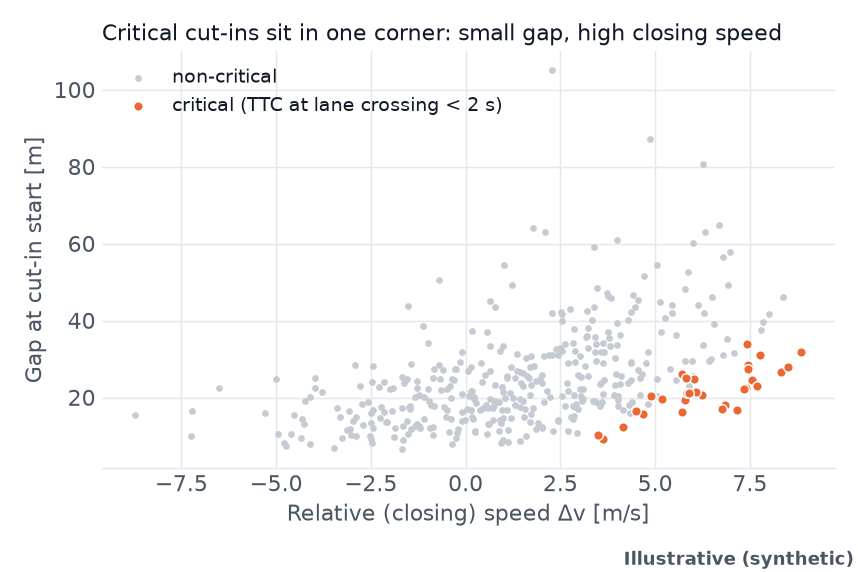
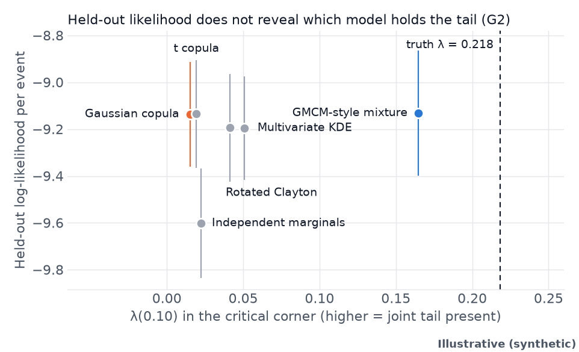
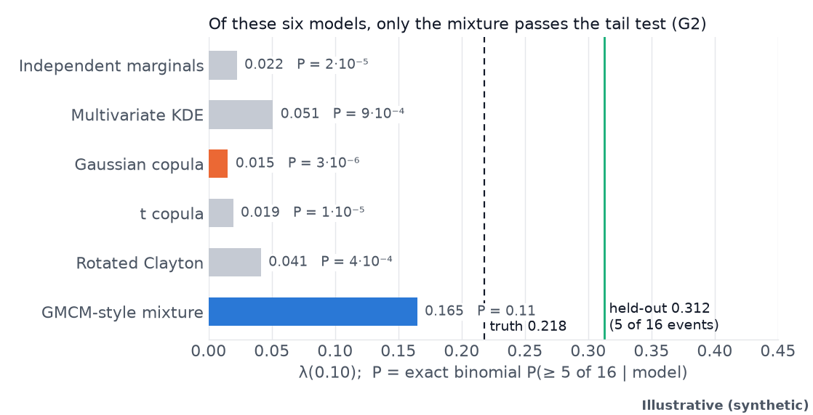
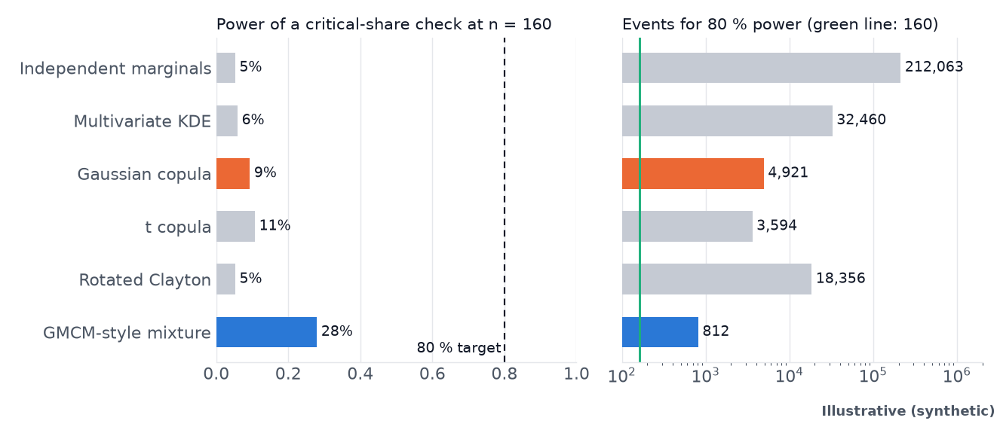
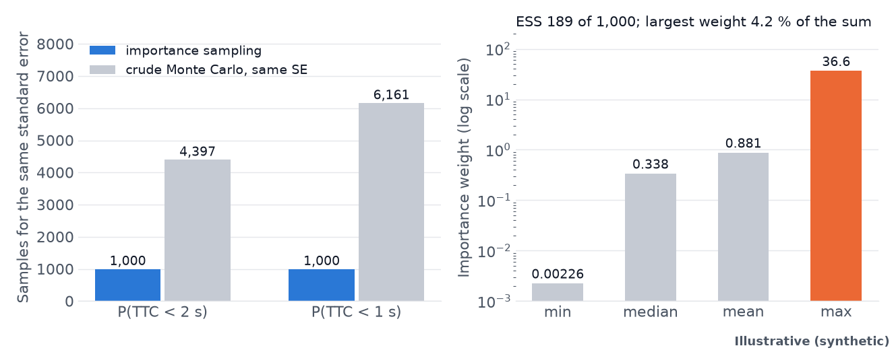
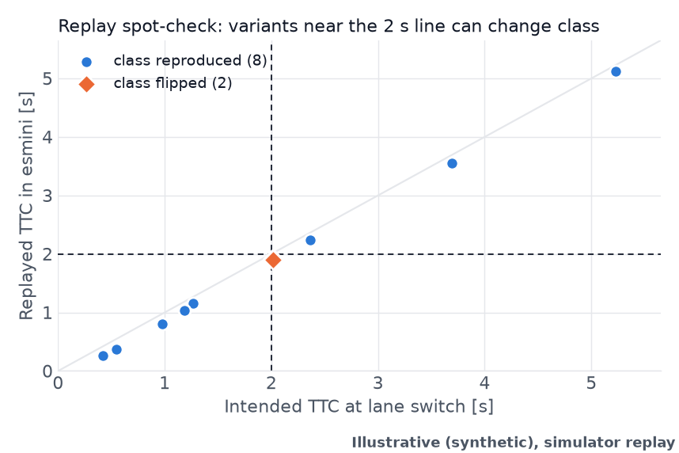

# Scenario validation test bed

Small, seeded, CPU-only code for two questions that come up when testing automated driving with scenarios:

1. **Screening.** Which moments in a long driving log are worth a human look?
2. **Generation.** If a model generates cut-in scenarios, does it keep the rare, dangerous combinations, and how many real events would you need to find out?

Everything below runs on **synthetic data with a known truth**, so each method can be checked against the right answer. These numbers say how the methods behave on designed generators. They say nothing about real traffic.

**Website:** not published yet, link to be added. **Slides:** to be linked from the website.

## Reproduce

Needs Python 3.12 and about 2 GB of disk for the dependencies. One command creates a virtual environment, regenerates every result and figure, and compares 67 published numbers with what was just computed:

```bash
make reproduce
```

The default interpreter is `python3.12`. Use `make reproduce PY=/path/to/python3.12` for another one. Run `make test` for the test suite.

The replay spot-check needs [esmini](https://github.com/esmini/esmini) (tested with 3.10.2). Point `ESMINI_BIN` at the binary, or put `esmini` on your `PATH`. Without it, the replay step and its numbers are reported as skipped and everything else still runs.

## Key results

All figures and numbers in this section are **Illustrative (synthetic)**. They come from one seeded run of each generator, with 400 cut-ins per generator (240 to fit, 160 held out).

### Screening a driving log

Three detectors run on time-to-collision and headway signals from a synthetic log with labelled events: a fixed threshold, change-point detection (PELT) and matrix-profile discords. Their union then goes through a physical gate, which keeps a flag only if time-to-collision drops below 4 s or time headway below 0.6 s.

| Detector | Precision | Recall | Flags |
|---|---|---|---|
| Threshold | 0.875 | 0.500 | 8 |
| PELT | 0.875 | 1.000 | 16 |
| Discords | 0.882 | 0.714 | 17 |
| Union | 0.878 | 1.000 | 41 |
| Union + gate | 0.878 | 1.000 | 41 |

The gate removes nothing here, because every flag in this log already meets the gate condition. Its value on real traffic is untested.

### What a cut-in looks like

λ(0.10) is the probability that a cut-in is in the lowest 10 % for time gap, given that it is in the highest 10 % for closing speed. If the two were independent it would be 0.10. Two generators produce the same kind of event. In G1, faster closing goes with larger gaps, so the two extremes rarely coincide (true λ(0.10) = 0.010). G2 adds a joint tail, so they coincide much more often (true λ(0.10) = 0.218).



*Illustrative (synthetic).*

### Likelihood does not see the tail

On G2, the Gaussian copula and the mixture model are level on held-out log-likelihood (−9.136 and −9.132 per event). Their tail dependence is not level: 0.015 against 0.165, with the truth at 0.218.



*Illustrative (synthetic).*

### A direct tail test does

Of the 160 held-out G2 events, 16 fall in the conditioning region and 5 of those are joint extremes. An exact binomial test asks how likely 5 or more of 16 would be under each model. Of the six models in this repository's generation chain, only the mixture is not rejected (P = 0.11). The other five give P below 0.001.



*Illustrative (synthetic).*

### The aggregate check is underpowered

A check on the share of critical events is the obvious alternative. At 160 held-out events its power on G2 ranges from 5 % to 28 % across the six models. Reaching 80 % would take between 812 and 212,063 events, depending on the model. These use a normal approximation.



*Illustrative (synthetic).*

### Importance sampling and replay

One cross-entropy step on the Gaussian copula reaches the standard error of about 4,400 crude samples for P(TTC < 2 s) and about 6,200 for P(TTC < 1 s), using 1,000 samples. The effective sample size is 189 of 1,000, and the largest single weight is 4.2 % of the sum.



*Illustrative (synthetic).*

Ten sampled variants were replayed open-loop in esmini. Eight kept their intended class, and the median absolute TTC error was 0.13 s. The two that changed class were intended at 2.015 s, just above the 2 s line, and replayed at about 1.9 s.



*Illustrative (synthetic), simulator replay.*

### Nine models in the companion notebook

[`notebooks/tail_fidelity.ipynb`](notebooks/tail_fidelity.ipynb) repeats the comparison with three more models: a vine copula, a conditional-extremes model and a small normalizing flow. They exist only in the notebook, and the numbers for the shared six match. Two of its results widen the picture above. A second model passes the tail test, with 7 of 9 rejected and the conditional-extremes model at P = 0.07. The flow's critical-share check has 60 % power at 160 events and needs 281 events for 80 %. Illustrative (synthetic).

## Limits

- The generators are designed, so "truth" is known here and only here.
- Each result is one seeded run. The P values and power figures describe this setup and are not a general ranking of the models.
- The mixture is a GMCM-style approximation (a Gaussian mixture on normal scores), not the full GMCM estimator.
- Replay is a spot-check of 10 variants with a constant-speed ego vehicle, in one simulator.
- The real-data code in `pilot/` is a working path, not a study. No real-data results are published here.

## Real data

No third-party data is stored in this repository. See [`data/README.md`](data/README.md) for the details.

| Dataset | How to get it | Code |
|---|---|---|
| NGSIM | `python pilot/download_ngsim.py --location us-101` | `load_ngsim` |
| highD | Apply and download it yourself under the dataset's licence | `load_highd` |
| Argoverse 2 Sensor | Download it yourself under the dataset's licence | `load_av2` |

The NGSIM path has been run end to end on one minute of US-101. The highD and Argoverse 2 loaders have only been tested on synthetic files written in each dataset's documented format, so expect to adjust them on first contact with the real files.

```bash
python pilot/screening.py --dataset ngsim --path data/raw/ngsim/us-101.csv --location us-101 --out results/pilot/us-101.csv
```

Candidates from this script are a queue for human review, not labelled events. Check the dataset's terms before publishing anything derived from it.

## Structure

```text
reproduce.py          one command: results, figures, comparison with published numbers
critical_events/      signals, detectors, fusion and gate, DTW similarity, POT tail fit,
                      cut-in generators and models (cutin_chain.py), synthetic and esmini logs,
                      CPU-sized learned and query-based detectors (eras.py)
experiments/          generation chain, power analysis, fusion scores, figures, number check
pilot/                real-data loaders, screening, NGSIM download
data/                 synthetic cut-ins and instructions for real datasets
results/              computed numbers (JSON and text)
figures/              README figures and generation diagnostics
notebooks/            companion notebook, nine-model comparison (own requirements)
tests/                unit, regression, loader and reproduction tests
```

## Tests

`pytest -q tests/` covers the detectors and signals, the regression set, the loaders, and a reproduction test that recomputes everything in a temporary folder and checks the 67 published numbers against `tests/data/published_numbers.json`. Replay numbers are skipped when esmini is absent, which includes the GitHub Actions workflow in `.github/workflows/ci.yml`. The notebook test needs its own environment (see [`notebooks/README.md`](notebooks/README.md)), is skipped in the main one, and runs separately in CI.

## Licence and citation

Code is under the [MIT licence](LICENSE). Figures and text are under [CC BY 4.0](LICENSE-content). See [`CITATION.cff`](CITATION.cff) to cite this work.
