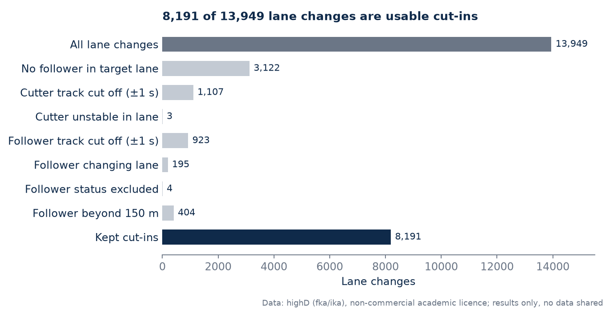
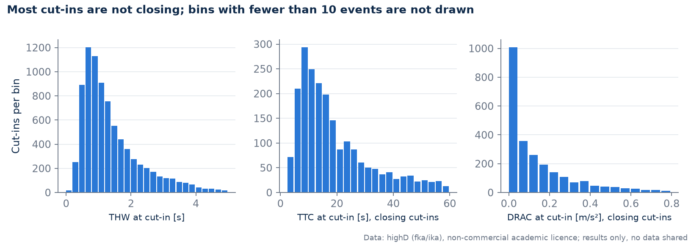
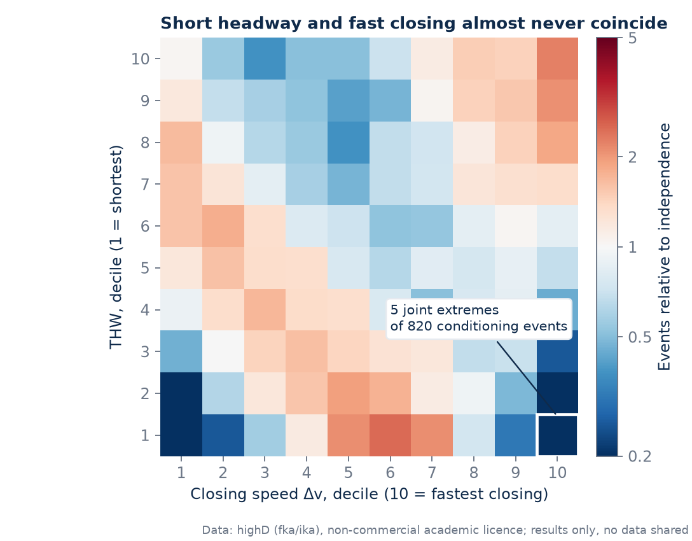
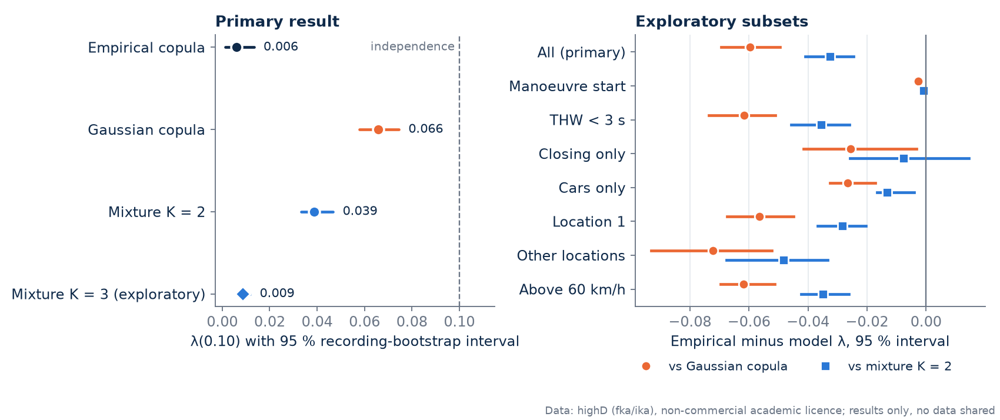
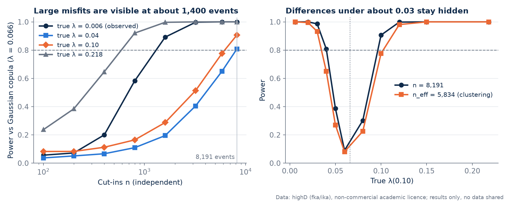

# highD pilot: tail fidelity on real cut-ins

*Generated by `experiments/highd_report.py` from `results/highd/*.json`. Own non-commercial research. No highD data, and no per-vehicle extract, is stored in this repository.*

**Headline.** Across 60 highD recordings, 8,191 cut-ins contain 5 joint extremes among 820 conditioning events, so λ(0.10) = 0.006 (95 % interval 0.001 to 0.013). The Gaussian copula gives 0.066 and the two-component mixture gives 0.039, and both overstate this corner. This is the opposite direction from the designed generator G2 in the synthetic results. Robustness analyses ([`docs/HIGHD_ROBUSTNESS.md`](HIGHD_ROBUSTNESS.md)) restrict this to the pooled corner of short headway and fast closing: it does not hold for truck followers or for the pair THW × lateral speed.

## Data and cut-in definition

The data are the 60 highD recordings: 110,516 vehicles, 16.7 h, 25 Hz, German motorways, 6 sites. `pilot/highd_cutins.py` reads them read-only.

A **cut-in** is a lane change of a cutter C into a target lane, at the first frame f_c of C in that lane, with a follower F behind it in the target lane. Filters, with the count each removes (13,949 lane changes in, 8,191 kept):

| Filter | Removed |
|---|---|
| No follower in the target lane at f_c | 3,122 |
| highD's `followingId` of C and `precedingId` of F disagree | 0 |
| C's track does not cover f_c ± 1 s (field-of-view edge) | 1,107 |
| C is not stable in origin lane before f_c and target lane after it | 3 |
| F's track does not cover f_c ± 1 s | 923 |
| F changes lane within f_c ± 1 s | 195 |
| `series.compute` status of F is `lane_change` or `collision` | 4 |
| F is more than 150 m behind C (`series.MAX_RANGE`) | 404 |
| F's speed below `series.V_MIN` | 0 |

Lane-change counts equal highD's metadata (13,949). THW, TTC and DRAC at f_c come from `critical_events/series.py` on the native 25 Hz frames of `pilot/loaders.py`, with no new formula. Across all kept cut-ins they agree with highD's own columns: 99th-percentile absolute difference 0.010 m for the gap and 0.010 s for THW, 5.5 % relative for TTC, and 100.0 % agreement on whether a cut-in is closing. C's centre is within 0.07 m of a lane marking at f_c (99th percentile). Closing speed is dv = v_F − v_C. The manoeuvre start t0 is the first frame of C's continuous lateral motion toward the target lane above 0.1 m/s, capped at 6 s.



## Surrogate measures at cut-in

Only 30.5 % of the cut-ins are closing at the moment of crossing. Median THW is 1.13 s and median gap 30 m. TTC is below 4 s in 27 cut-ins, below 3 s in 7 and below 2 s in 0. DRAC exceeds 2 m/s² in 3 and 4 m/s² in 0. The share of cut-ins with TTC below 2 s (the danger value of UN R157's cut-in driver model, Annex 4; not a pass criterion, which in R157 §5.2.5.2 is no collision under stated conditions) is therefore zero, with a one-sided 95 % upper bound of 3.66e-04. THW is short much more often: below 0.6 s in 1,162 cut-ins and below 0.3 s in 90.



### Screening

The detectors, union and physical gate from `pilot/screening.py` ran unchanged on 10 Hz frames. Vehicles need at least 12 s of track, so 6,824 of 8,191 cut-ins could be screened (1,367 not). Flag rates come from a seeded random 10 % control sample, 8,136 of 82,108 screenable vehicles. Screening all of them would need about 6 CPU-hours.

| Detector | Control flags | Vehicles flagged | Cut-ins caught, all (6,824) | TTC < 4 s (18) | TTC 4 to 8 s (195) | TTC ≥ 8 s (1,255) |
|---|---|---|---|---|---|---|
| Threshold (TTC < 3 s) | 18 | 0.2 % | 6 (0.1 %) | 6 (33.3 %) | 0 (0.0 %) | 0 (0.0 %) |
| PELT | 128 | 1.5 % | 50 (0.7 %) | 18 (100.0 %) | 31 (15.9 %) | 0 (0.0 %) |
| Discords | 176 | 2.0 % | 105 (1.5 %) | 9 (50.0 %) | 59 (30.3 %) | 32 (2.5 %) |
| Union | 322 | 2.8 % | 136 (2.0 %) | 18 (100.0 %) | 80 (41.0 %) | 32 (2.5 %) |
| Union + gate | 201 | 1.6 % | 62 (0.9 %) | 18 (100.0 %) | 36 (18.5 %) | 5 (0.4 %) |

The gate removed 38 % of union flags on the control sample, which the synthetic log could not show. 14 of 201 gated control flags (7 %) overlap a cut-in. Screening keys on TTC: union + gate catches only 16 of 1,038 cut-ins with THW below 0.6 s. A cut-in is not a label for danger, so these rates describe what the detectors react to. They are not precision or recall.

## Tail fidelity

Primary specification, fixed before any tail result was computed: pair (THW, dv) at lane crossing, q = 0.10, λ(q) = P(THW in its lowest q | dv in its highest q), using `cutin_chain.tail_dependence`. In physical units the corner is roughly THW below 0.53 s with dv above 4.09 m/s. Models are `GaussianCopula` and `GMMScores` (K = 2) from `critical_events/cutin_chain.py`. The empirical copula's λ is the sample value. Intervals are a percentile bootstrap by recording (2000 replicates), with all models re-fitted in each.

| Model | λ(0.10) | 95 % interval | Empirical minus model (95 % interval) |
|---|---|---|---|
| Empirical copula | 0.006 | 0.001 to 0.013 | |
| Gaussian copula | 0.066 | 0.058 to 0.075 | -0.060 (-0.069 to -0.049) |
| Mixture, K = 2 | 0.039 | 0.033 to 0.047 | -0.033 (-0.041 to -0.025) |

Independence would give 0.10, so real cut-ins avoid this corner, and the Spearman correlation of the pair is 0.15. **Joint extremes:** 5 of 820 at q = 0.10, 1 of 410 at q = 0.05, 0 of 164 at q = 0.02, 0 of 82 at q = 0.01, and 85 of 1639 at q = 0.20.



Held-out check, fitting on 36 recordings and testing on 24 (3,429 events): 3 joint extremes of 343, λ = 0.009. Exact binomial, two-sided, treating held-out events as independent: Gaussian (λ 0.067) P = 2·10⁻⁷; mixture K = 2 (λ 0.039) P = 1·10⁻³; training-set empirical (λ 0.004) P = 0.18. Held-out copula log-likelihood per event is 0.007 for the Gaussian and 0.092 for the mixture, so on this data likelihood and the tail metric point the same way.

Exploratory sensitivity, recording bootstrap with 400 replicates, no multiplicity correction:

| Variant | n | Conditioning | Joint | Empirical | Gaussian | Mixture | Emp − Gaussian | Emp − mixture |
|---|---|---|---|---|---|---|---|---|
| Pair at manoeuvre start | 4,534 | 454 | 0 | 0.000 | 0.003 | 0.001 | -0.004 to -0.002 | -0.002 to -0.000 |
| q = 0.05 | 8,191 | 410 | 1 | 0.002 | 0.028 | 0.019 | -0.033 to -0.017 | -0.021 to -0.008 |
| q = 0.20 | 8,191 | 1639 | 85 | 0.052 | 0.153 | 0.102 | -0.112 to -0.090 | -0.062 to -0.039 |
| Mixture K = 3 | 8,191 | 820 | 5 | 0.006 | 0.066 | 0.009 | -0.068 to -0.048 | -0.008 to 0.004 |
| THW below 3 s | 7,529 | 753 | 7 | 0.009 | 0.071 | 0.045 | -0.074 to -0.051 | -0.046 to -0.026 |
| Closing only | 2,497 | 250 | 4 | 0.016 | 0.042 | 0.024 | -0.042 to -0.003 | -0.026 to 0.015 |
| Cars only | 4,631 | 464 | 1 | 0.002 | 0.029 | 0.015 | -0.033 to -0.017 | -0.017 to -0.004 |
| Location 1 | 6,251 | 626 | 4 | 0.006 | 0.063 | 0.035 | -0.067 to -0.045 | -0.037 to -0.020 |
| Other locations | 1,940 | 194 | 1 | 0.005 | 0.077 | 0.053 | -0.093 to -0.052 | -0.068 to -0.033 |
| Above 60 km/h | 8,045 | 805 | 4 | 0.005 | 0.067 | 0.040 | -0.070 to -0.051 | -0.042 to -0.026 |

Two points are worth noting. A mixture with K = 3 matches the corner (difference includes zero), but K was not pre-specified, and BIC picks K = 5 from the K = 1 to 5 tried, so model order drives the result. Among closing cut-ins only the Gaussian difference stays clear of zero, and only just.



## Power

Test: T = λ_empirical − λ_Gaussian(ρ̂), with the Gaussian re-fitted per data set, rejecting when T leaves the central 95 % under a Gaussian with the real ρ (0.123, exact λ 0.066). Truths are that Gaussian perturbed only in the corner to a chosen λ. Each cell has 2000 simulations and the type I error ranged 0.04 to 0.06. Clustering inflates the variance of the difference by a design effect of 1.40, so 8,191 events behave like about 5,834 independent ones.

- The observed gap to the Gaussian is detected with power 1.00 at this n. It would reach 80 % power at about 1,362 independent events, about 1,913 once the design effect is applied. Resampling real recordings agrees: 41 % of draws reject with 5 recordings and 90 % with 10 (about 1,363 events).
- At 80 % power and n = 5,834 effective events, the smallest detectable departures from the Gaussian are λ ≤ 0.035 or λ ≥ 0.102 (-0.031 or +0.036). Treating all 8,191 as independent gives λ ≤ 0.040 or ≥ 0.096.
- Exact binomial test on the corner hits (treating the model's λ as known): against the K = 2 mixture, 80 % power needs about 2,090 events. The K = 3 mixture has power 0.04 here and would need about 100,650. So a model close to the observed corner cannot be told apart from it with this data.
- The relative width of the empirical interval is 198 % of the estimate. λ itself is only known to within roughly a factor of ten, even though its distance from the Gaussian is clear.



## Limits

- One dataset, German motorways, 16.7 h, 6 sites, with 76 % of cut-ins from one site. The result does not extend to other roads or countries.
- λ is taken at the crossing frame. Followers may already have reacted, so this measures the state after any anticipation, and the minimum TTC after the cut-in is not studied.
- Selection: 2,030 lane changes are lost at the edge of the about 420 m field of view, 3,122 have no visible follower, and 1,367 kept cut-ins are too short for screening. Pair-at-manoeuvre-start events need C ahead of F at t0, leaving 4,534 events.
- Models are fitted to one pair, not four parameters. Only the Gaussian copula and a K = 2 mixture were pre-specified; the mixture is GMCM-style, not the full estimator.
- Bootstrap fits use rank marginals for speed. On a 3,000-event subsample the testbed's KDE marginals give λ 0.063 (Gaussian) and 0.046 (mixture) against 0.067 and 0.039 with rank marginals, which is small next to the differences reported.
- Recordings are treated as independent clusters, although most come from one site, so between-site uncertainty is understated. Simulated power uses a perturbed-Gaussian truth, which is one assumption about the alternative.
- Screening covers followers and a 10 % control sample, not every vehicle, and there are no labels. The 12 `collision` frames in the control sample (gap ≤ 0) were not inspected individually and are not claimed to be collisions.
- highD's trajectories come from automated drone-video processing, and their errors are not modelled here.

## Reproduce and traceability

Needs your own highD copy; the default path is `~/datasets/highD/data`, or set `HIGHD_DATA`. Per-event tables go to `~/.cache/scenario-validation-testbed/highd` (or `HIGHD_WORK`), and the code refuses a path inside this repository.

```bash
python pilot/highd_cutins.py             # about 25 min with 3 worker processes
python experiments/highd_screening.py
python experiments/highd_tail.py         # about 15 min
python experiments/highd_power.py        # about 7 min
python experiments/highd_figures.py      # add --plot-only to redraw from the JSON files without the data
python experiments/highd_report.py
```

| Numbers | Result file (key) | Script |
|---|---|---|
| Recordings, funnel, checks, control screening counts | `results/highd/extraction.json` | `pilot/highd_cutins.py` |
| Catch rates, flag rates | `results/highd/screening.json` | `experiments/highd_screening.py` |
| Severity counts, λ, intervals, held-out test, sensitivity, BIC | `results/highd/tail.json` (`severity`, `primary`, `heldout`, `sensitivity`, `bic`, `joint_extremes_by_q`) | `experiments/highd_tail.py` |
| Power, design effect, detectable differences, binomial, critical-share bound | `results/highd/power.json` | `experiments/highd_power.py` |
| Histograms and decile counts in the figures | `results/highd/aggregates.json` | `experiments/highd_figures.py` |
| Every number in this report | The files above, inserted by formatting code | `experiments/highd_report.py` |

Plots contain only aggregated counts and fitted statistics: no scatter plots, time series, or per-vehicle values, and physical-unit bins below 10 events are suppressed. No per-event minimum or maximum is reported.

## Data, licence and citation

highD is used under its non-commercial licence: access is by application at <https://www.highd-dataset.com/>, redistribution is not permitted, and this repository holds results only.

R. Krajewski, J. Bock, L. Kloeker and L. Eckstein, "The highD Dataset: A Drone Dataset of Naturalistic Vehicle Trajectories on German Highways for Validation of Highly Automated Driving Systems," in *2018 21st International Conference on Intelligent Transportation Systems (ITSC)*, 2018, pp. 2118–2125, doi:10.1109/ITSC.2018.8569552.
