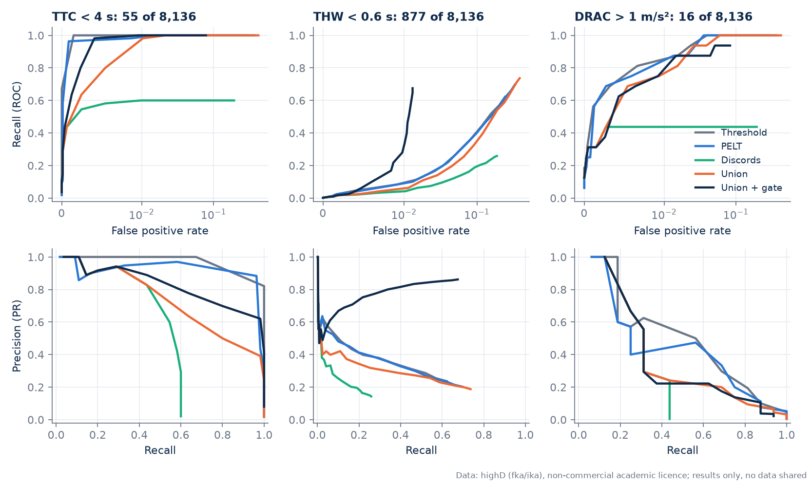
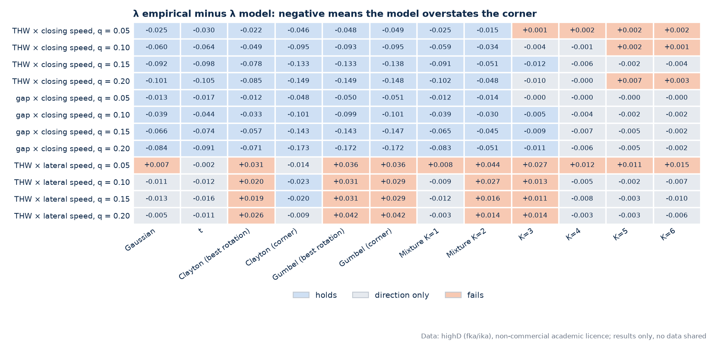
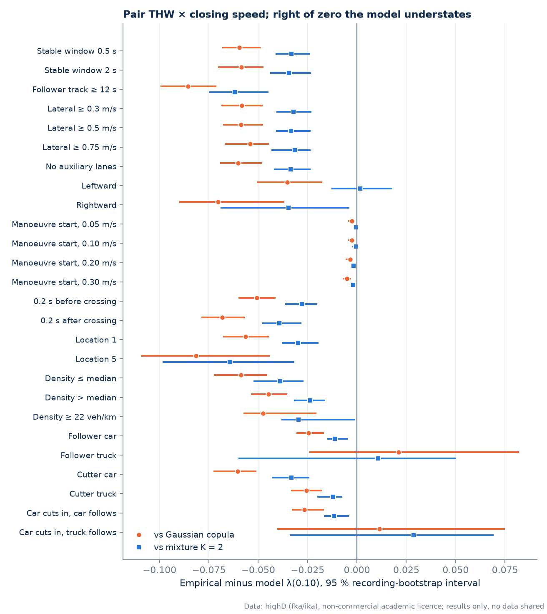
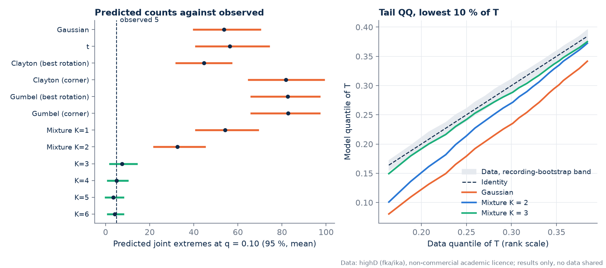
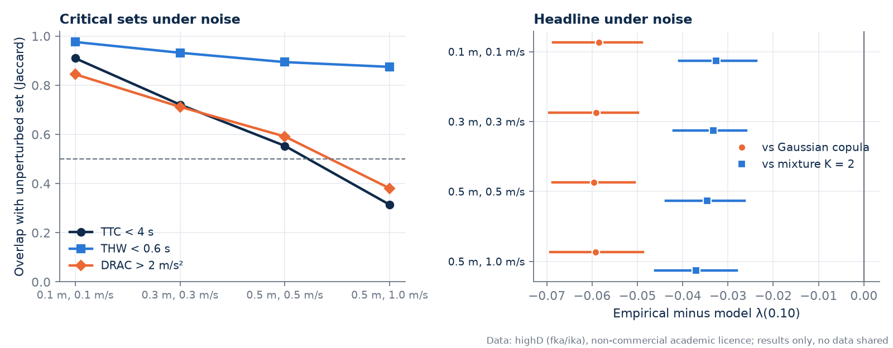

# highD pilot: robustness analyses

*Generated by `experiments/highd_robust_report.py` from `results/highd/robust_*.json`. Plan committed before any analysis ran: [`docs/HIGHD_ANALYSIS_PLAN.md`](HIGHD_ANALYSIS_PLAN.md). Data: highD, used under its non-commercial licence; results only, no data shared. Cite Krajewski et al., ITSC 2018, doi:10.1109/ITSC.2018.8569552.*

**Result.** On pooled cut-ins the headline survives the planned stresses of the (THW, closing speed) corner: level, gap in metres, leave-one-out, density and noise, and all definition variants except that the two-component mixture does not overstate it for leftward lane changes. It does not generalise in two ways, and the plan counts both as changing the conclusion. For **truck followers** the corner is not avoided (λ(0.10) = 0.225) and neither model overstates it. For the pair **THW × lateral speed** the corner is populated (λ(0.10) = 0.130) and the two-component mixture understates it. The claim should read: *for the pooled corner of short headway and fast closing, the Gaussian copula and the two-component mixture overstate the tail.*

## Summary

| Analysis | Result | Does the headline hold? |
|---|---|---|
| 1. Screening, vehicle level (control sample) | Against TTC < 4 s (55 of 8,136 vehicles), union + gate has recall 1.00 and precision 0.41; against THW < 0.6 s recall 0.10, precision 0.67. | Screening statement holds. Most flags are outside the TTC < 4 s reference. |
| 1. Screening, cut-in level | Union + gate recall 1.00 at TTC < 4 s, 0.015 at THW < 0.6 s. | Holds under the plan's limits (recall ≥ 0.9 and ≤ 0.5). |
| 2. Level q on THW × closing speed | Four levels: Gaussian holds in 4, K = 2 in 4. | Yes |
| 2. Pair gap × closing speed | q = 0.10: λ 0.000, Gaussian 0.039, K = 2 0.030. | Yes: Gaussian holds, K = 2 holds. |
| 2. Pair THW × lateral speed | q = 0.10: λ 0.130 (above independence), Gaussian 0.142, K = 2 0.103. | **No.** Gaussian direction only, K = 2 fails. This corner is populated. |
| 2. Families on THW × closing speed | Gaussian, t, Clayton and Gumbel (best rotation) and K = 2: all overstate at q = 0.10. K = 3 to 6 do not: Δ -0.004 to 0.001. | Yes for the pre-stated families; not for K ≥ 3, as expected. |
| 2. Cut-in definition variants | 15 interpretable. Gaussian holds in 15, K = 2 in 14; K = 2 fails: Leftward. | Yes, not fragile under the plan's quarter rule. |
| 3. Leave one recording out | Over all 60 removals, Δ Gaussian -0.060 to -0.056, Δ K = 2 -0.035 to -0.029. | Yes |
| 3. Per location | Interpretable: 1 (Gaussian holds, K = 2 holds) and 5 (Gaussian holds, K = 2 holds). Locations 2, 3, 4 and 6 have too few recordings or events. | Yes where interpretable; four of six sites cannot be judged. |
| 3. Free flow against dense | Below median density: Gaussian holds, K = 2 holds. Above: Gaussian holds, K = 2 holds. At least 22 veh/km: Gaussian holds, K = 2 holds. | Yes |
| 3. Car against truck | Follower car: λ 0.002, Gaussian holds, K = 2 holds. Follower truck: λ 0.225 (interval 0.159 to 0.306), Gaussian fails, K = 2 fails. | **No for truck followers**, a trigger under the plan. See the post hoc note. |
| 4. Predictive joint extremes | Observed 5 at q = 0.10. Gaussian predicts 40 to 70, K = 2 22 to 45. Consistent models: K=3, K=4, K=5, K=6. | Yes: neither pre-specified model is consistent with the data. |
| 5. Measurement noise | Up to (0.3 m, 0.3 m/s): Gaussian holds, K = 2 holds. TTC < 4 s set overlap 0.91 at (0.1, 0.1), 0.72 at (0.3, 0.3). | Yes |

H1 (corner avoided) is checked per configuration in the JSON files. Its interval is not below independence for: Rightward, Follower truck, Car cuts in, truck follows, Truck cuts in, truck follows, and for 4 of the 4 levels of THW × lateral speed.

## 1. Screening as a classifier

The references come from the same signals as the detectors, and the gate tests TTC < 4 s or THW < 0.6 s directly, so this measures agreement with a rule and not independent validity. Vehicle-level positives in the control sample of 8,136: TTC < 4 s: 55; THW < 0.6 s: 877; DRAC > 1 m/s²: 16, DRAC > 2 m/s²: 2, DRAC > 3 m/s²: 1. The DRAC references have too few positives to read: areas are not shown below 10 positives (a post hoc rule).

| Method | TTC ROC AUC | Recall | Precision | Miss | THW ROC AUC | Recall | Precision | Miss |
|---|---|---|---|---|---|---|---|---|
| Threshold | 1.00 | 0.33 | 1.00 | 0.67 | 0.71 | 0.01 | 0.56 | 0.99 |
| PELT | 1.00 | 0.98 | 0.44 | 0.02 | 0.72 | 0.07 | 0.52 | 0.93 |
| Discords | 0.76 | 0.60 | 0.20 | 0.40 | 0.54 | 0.06 | 0.33 | 0.94 |
| Union | 1.00 | 1.00 | 0.24 | 0.00 | 0.72 | 0.11 | 0.42 | 0.89 |
| Union + gate | 1.00 | 1.00 | 0.41 | 0.00 | 0.83 | 0.10 | 0.67 | 0.90 |

Confusion matrices (vehicle level), TP / FP / FN / TN:

| Method | TTC < 4 TP | FP | FN | TN | THW < 0.6 TP | FP | FN | TN |
|---|---|---|---|---|---|---|---|---|
| Threshold | 18 | 0 | 37 | 8081 | 10 | 8 | 867 | 7251 |
| PELT | 54 | 70 | 1 | 8011 | 65 | 59 | 812 | 7200 |
| Discords | 33 | 132 | 22 | 7949 | 55 | 110 | 822 | 7149 |
| Union | 55 | 173 | 0 | 7908 | 96 | 132 | 781 | 7127 |
| Union + gate | 55 | 78 | 0 | 8003 | 89 | 44 | 788 | 7215 |

Intervals for each rate, the cut-in-level tables and all sweeps are in `results/highd/robust_screening.json`. Threshold sweep curves are below, and the discord detector's recall saturates because its relative criterion does not scale with the factor.

## 2. Tail sensitivity

Cells show λ empirical minus λ model, so a negative value means the model overstates the corner, coloured by the plan's verdict.

Primary pair, q = 0.10 (empirical λ 0.006, interval 0.001 to 0.014, 5 joint extremes of 820):

| Model | λ | Empirical − model (95 %) | Verdict | Predicted joint extremes | Consistent with data |
|---|---|---|---|---|---|
| Gaussian | 0.066 | -0.060 (-0.068 to -0.048) | holds | 40 to 70 | no |
| t | 0.070 | -0.064 (-0.076 to -0.050) | holds | 41 to 74 | no |
| Clayton (best rotation) | 0.055 | -0.049 (-0.057 to -0.039) | holds | 32 to 57 | no |
| Clayton (corner) | 0.101 | -0.095 (-0.101 to -0.085) | holds | 65 to 99 | no |
| Gumbel (best rotation) | 0.099 | -0.093 (-0.101 to -0.086) | holds | 66 to 97 | no |
| Gumbel (corner) | 0.101 | -0.095 (-0.101 to -0.086) | holds | 66 to 97 | no |
| Mixture K=1 | 0.065 | -0.059 (-0.069 to -0.049) | holds | 41 to 69 | no |
| Mixture K=2 | 0.040 | -0.034 (-0.041 to -0.023) | holds | 22 to 45 | no |
| K=3 | 0.010 | -0.004 (-0.008 to 0.004) | direction only | 2 to 14 | yes |
| K=4 | 0.007 | -0.001 (-0.005 to 0.007) | direction only | 1 to 10 | yes |
| K=5 | 0.004 | 0.002 (-0.003 to 0.009) | fails | 0 to 8 | yes |
| K=6 | 0.005 | 0.001 (-0.003 to 0.007) | fails | 1 to 8 | yes |

Auxiliary lanes under the plan's rule: 3 recordings (58, 59, 60). I did not check these against site maps. 39 cut-ins start in one, and none end in one, so the only-from-auxiliary variant is not interpretable.

## 3. Stability

Leave-one-recording-out: λ empirical ranges 0.005 to 0.008, and no removal gives Δ ≥ 0 for either model. The density median is 13.9 veh/km.

**Post hoc note on trucks (not in the plan).** λ is rank-based inside each stratum. For truck followers the top decile of closing speed starts at -1.66 m/s, which is negative, and only 3.4 % of them are closing at crossing. So that stratum's corner is short headway with the *least-opening* cut-ins, not fast closing. At the pooled thresholds (THW ≤ 0.53 s, dv > 4.09 m/s) truck followers have 0 joint extremes in 16 conditioning events, and 801 of the pooled conditioning events have car followers. The same applies to rightward lane changes (4.7 % closing). The stratum failures are therefore mainly a statement about how a within-stratum rank corner is defined. I report them as failures because the plan does, and because the pooled figure is a statement about a car-dominated fast-closing corner.

## 4. Model checks

Predictive counts use the recording-bootstrap fits as an approximate posterior, which is not a formal Bayesian posterior. Neither the Gaussian copula nor the two-component mixture is consistent with the observed count; mixtures with K ≥ 3 are, which shows how flexible they are and is not evidence that any of them is the right model.

## 5. Measurement noise

Baseline critical sets: TTC < 4 s 27, TTC < 2 s 0, THW < 0.6 s 1,162, DRAC > 2 m/s² 3.

| Noise (position, speed) | TTC < 4 s (mean count) | Jaccard | TTC < 2 s (mean count) | THW < 0.6 s Jaccard | DRAC > 2 Jaccard | λ emp | Gaussian | K = 2 |
|---|---|---|---|---|---|---|---|---|
| 0.1 m, 0.1 m/s | 27.2 | 0.91 | 0.0 | 0.98 | 0.84 | 0.007 | holds | holds |
| 0.3 m, 0.3 m/s | 30.7 | 0.72 | 0.4 | 0.93 | 0.71 | 0.007 | holds | holds |
| 0.5 m, 0.5 m/s | 36.1 | 0.55 | 1.0 | 0.89 | 0.59 | 0.007 | holds | holds |
| 0.5 m, 1.0 m/s | 58.8 | 0.31 | 2.9 | 0.87 | 0.38 | 0.010 | holds | holds |

Small critical sets are sensitive: the TTC < 4 s set has an overlap of 0.72 at (0.3, 0.3) and 0.31 at the stress level. The tail conclusion is not.

## Deviations from the plan and post hoc items

- Noise: critical sets use 200 draws as planned. λ intervals add 400 replicates that each combine a recording bootstrap with a fresh noise draw, so that "all intervals by recording" holds.
- A stable window of 1 s is the primary and was not re-run. No cut-in ends in an auxiliary lane, so that variant has no events.
- ROC and PR areas are not shown when a reference has fewer than 10 positives (post hoc).
- The truck diagnostic (`experiments/highd_robust_posthoc.py`) is post hoc.
- B = 400 throughout, with no reduction.
- Already seen before the plan: the primary result, q = 0.05 and 0.20, K = 3, and some subsets. These are not confirmatory.

## Limits

No multiple-testing correction: counts of configurations are descriptive. Recordings are correlated within a site. The noise model is independent Gaussian at the crossing frame, with assumed levels. References for screening share signals with the detectors. The auxiliary-lane rule is untested against site maps. Model fits are bivariate.

## Traceability

| Numbers | Result file | Script |
|---|---|---|
| Definition variants, density, auxiliary lanes | `results/highd/robust_candidates.json` and tables outside the repository | `pilot/highd_candidates.py` |
| Confusion matrices, ROC, PR | `results/highd/robust_screening.json` | `experiments/highd_robust_screening.py` |
| Levels, pairs, families, variants | `results/highd/robust_tail.json` | `experiments/highd_robust_tail.py` |
| Leave-one-out, locations, density, classes | `results/highd/robust_stability.json` | `experiments/highd_robust_tail.py` |
| Predictive counts, tail QQ | `results/highd/robust_checks.json` | `experiments/highd_robust_tail.py` |
| Noise | `results/highd/robust_noise.json` | `experiments/highd_robust_noise.py` |
| Post hoc truck diagnostic | `results/highd/robust_posthoc.json` | `experiments/highd_robust_posthoc.py` |
| All tables and figures in this report | The files above | `experiments/highd_robust_report.py` |
